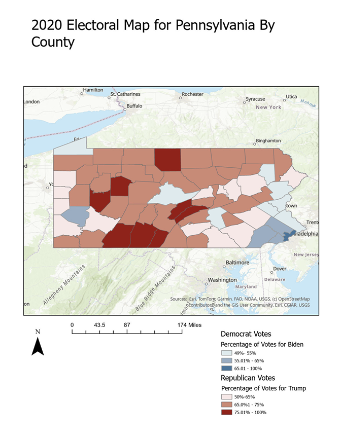
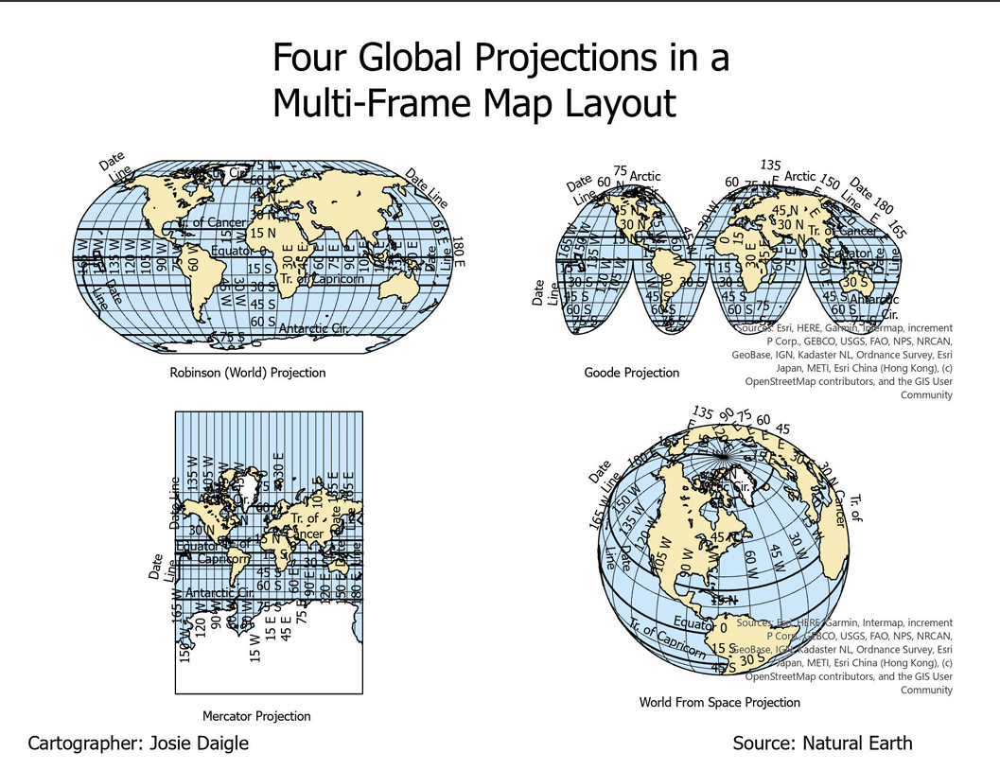

---
title: GIS Projects
nav_order: 3
---

# GIS Projects

A collection of geographic information systems projects exploring political geography, cartography, and environmental vulnerability. These projects demonstrate my experience using ArcGIS Pro to analyze spatial data and communicate geographic patterns through maps.

---

## 2020 Pennsylvania Electoral Map

This map illustrates the distribution of votes cast for Joe Biden and Donald Trump across Pennsylvania counties during the 2020 presidential election. Counties are symbolized using graduated colors to show the percentage of votes received by each candidate, highlighting regional differences in political support.

**GIS Skills**
- Joining tables
- Attribute table analysis
- Graduated symbology
- Color visualization
- Map design and layout

---

## Comparing Four Global Map Projections

This project compares four global map projections: Robinson, Goode Homolosine, Mercator, and World From Space. Using four map frames with the same geographic data, it demonstrates how different coordinate reference systems affect the representation of the Earth's surface.

**GIS Skills**
- Coordinate reference systems
- Map symbology
- Graticule creation and display
- Map frames and layouts
- Cartographic design

---

## Flint, Michigan Water Vulnerability Analysis

This project uses proximity-based buffer analysis to identify areas in Flint, Michigan, where environmental hazards and lead water service lines may overlap. The analysis considers TRI facilities with water pollution exceeding 10,000 tons, nearby rivers, and service lines identified as lead. The resulting map highlights areas for further investigation.

**GIS Skills**
- Attribute querying and selection
- Buffer analysis
- Dissolve
- Spatial analysis
- Cartographic design
